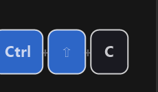

# OctopusKey

<p align="center"></p>

[简体中文](#简体中文) | [English](#english)

## 简体中文

**OctopusKey** 是一个免费开源的实时按键与鼠标操作可视化工具([KeyViz](https://keyviz.org) 的原生 Windows 替代品),使用 Lazarus / Free Pascal 编写。

按下按键时,屏幕上会浮现键帽组合(如 `Ctrl + ⇧ + C`),让观众清楚地看到你使用的每一个快捷键——适合录屏、直播、演示和教学场景。鼠标点击和滚轮滚动则以跟随光标的涟漪与箭头提示呈现。



### 功能特性

- **悬浮键帽** —— 修饰键(Ctrl、Alt、⇧、Win)采用主题强调色,普通键为深色键帽,以 `+` 连接,带平滑的进出场动画
- **历史轨迹** —— 最近几次组合向上堆叠并淡出(0–5 行,可配置)
- **鼠标可视化** —— 左 / 右 / 中键彩色点击涟漪、滚轮方向箭头,跟随光标移动
- **过滤规则** —— 忽略自动重复、仅显示组合键、按键黑名单(如 `Win, F5`)
- **样式定制** —— 深色 / 浅色 / 自定义主题,键帽颜色、修饰键颜色、文字与边框颜色、圆角、不透明度、缩放、字号
- **位置预设** —— 九宫格屏幕锚点 + 可调边距
- **双语界面** —— 中文 / English,默认跟随系统语言
- **托盘常驻** —— 静默运行于系统托盘,`--show-settings` 可直接打开设置
- **隐私安全** —— 所有输入仅在本地处理,不会发送任何数据

### 下载 / 构建

暂无预编译发布版 —— 从源码构建(一条命令,零运行时依赖):

```
git clone https://github.com/xw5/octopus-key.git
cd octopus-key
C:\lazarus\lazbuild.exe -B octopuskey.lpi
```

产出:`bin\OctopusKey.exe`(原生 Windows x64)。需要 [Lazarus](https://www.lazarus-ide.org/) 与 FPC 3.2.2;调试版用 `--build-mode=Debug`(含 DWARF 调试信息,输出 `bin\OctopusKey-dbg.exe`)。

### 使用方法

1. 运行 `OctopusKey.exe` —— 程序驻留系统托盘;单击托盘图标打开设置(或用 `--show-settings` 启动)。
2. 按任意键 —— 键帽按配置的位置浮现。
3. 右键托盘图标 → **退出**。

设置保存在 `%APPDATA%\OctopusKey\config.json`,修改实时生效。

### 项目结构

```
octopuskey.lpi/.lpr     Lazarus 项目(Win64 GUI)
src/hooks.pas           全局低级键盘/鼠标钩子 + 环形缓冲
src/overlay.pas         分层键帽窗口:组合状态机、动画、历史轨迹
src/render.pas          GDI+ 键帽绘制(圆角、边框、符号字形)
src/mouseoverlay.pas    跟随光标的点击涟漪 / 滚轮提示窗口
src/gdip.pas            最小化 GDI+ 平面 API 绑定
src/keymap.pas          虚拟键码 → 键帽文本/字形映射
src/config.pas          设置记录 + JSON 持久化
src/langstrings.pas     中英文字符串表
src/main.pas            设置窗口 + 托盘图标
```

### 技术说明

- 输入捕获使用 `WH_KEYBOARD_LL` / `WH_MOUSE_LL` 全局低级钩子;事件复制进环形缓冲后以消息通知 UI 线程,绝不阻塞输入管线。
- 覆盖层为 per-pixel alpha 分层窗口(`WS_EX_LAYERED | WS_EX_TRANSPARENT | WS_EX_NOACTIVATE`),用 GDI+ 平面 API(`gdiplus.dll`,系统自带)渲染,零额外依赖。
- 渲染完全在本地进行;无动画时空闲不重绘(CPU 占用为 0)。

### 许可证

待定 —— 发布前请选定(如 MIT 或 GPL-3.0)。

### 致谢

灵感来自 [KeyViz](https://keyviz.org)(mulaRahul)。

---

## English

**OctopusKey** is a free, open-source tool that visualizes your keystrokes and mouse actions in real time — a native Windows alternative to [KeyViz](https://keyviz.org), built with Lazarus / Free Pascal.

When you press keys, floating keycaps appear on screen (e.g. `Ctrl + ⇧ + C`), so your audience can follow every shortcut during screencasts, live streams, presentations and tutorials. Mouse clicks and wheel scrolling are shown as ripples and arrows that follow your cursor.


### Features

- **Floating keycap overlay** — modifiers (Ctrl, Alt, ⇧, Win) in accent color, regular keys in dark caps, joined with `+`, with smooth enter/leave animations
- **History trail** — the last few combos stack up and fade out (0–5 rows, configurable)
- **Mouse visualization** — colored click ripples for left / right / middle button and scroll direction hint, following the cursor
- **Filters** — ignore auto-repeat, show only combos (modifier + key), per-key blacklist (e.g. `Win, F5`)
- **Styling** — dark / light / custom themes, keycap color, modifier color, text and border colors, corner radius, opacity, scale and font size
- **Position presets** — 9-grid screen anchor with adjustable margin
- **Bilingual UI** — Chinese / English, or follow the system language (default)
- **Tray-friendly** — runs quietly in the system tray, `--show-settings` opens settings directly
- **Privacy** — all input is processed locally, nothing is ever sent anywhere

### Download / Build

No release binaries yet — build from source (one command, no runtime dependencies):

```
git clone https://github.com/xw5/octopus-key.git
cd octopus-key
C:\lazarus\lazbuild.exe -B octopuskey.lpi
```

Output: `bin\OctopusKey.exe` (native Windows x64). Requires [Lazarus](https://www.lazarus-ide.org/) with FPC 3.2.2; use `--build-mode=Debug` for a debug build with DWARF info (`bin\OctopusKey-dbg.exe`).

### Usage

1. Run `OctopusKey.exe` — it lives in the system tray; click the tray icon to open settings (or run with `--show-settings`).
2. Press any keys — keycaps appear at the configured screen position.
3. Right-click the tray icon → **Exit** to quit.

Settings are stored in `%APPDATA%\OctopusKey\config.json` and applied live.

### Project layout

```
octopuskey.lpi/.lpr     Lazarus project (Win64 GUI)
src/hooks.pas           global low-level keyboard/mouse hooks + ring buffer
src/overlay.pas         layered keycap window: cluster state machine, animations, trail
src/render.pas          keycap drawing on GDI+ (rounded caps, borders, glyphs)
src/mouseoverlay.pas    cursor-following click ripple / wheel hint window
src/gdip.pas            minimal flat-API GDI+ binding
src/keymap.pas          VK code → keycap label/glyph mapping
src/config.pas          settings record + JSON persistence
src/langstrings.pas     zh/en string table
src/main.pas            settings window + tray icon
```

### Technical notes

- Input is captured with `WH_KEYBOARD_LL` / `WH_MOUSE_LL` global hooks; events are copied into a ring buffer and posted to the UI thread, so the input pipeline is never blocked.
- Overlays are per-pixel-alpha layered windows (`WS_EX_LAYERED | WS_EX_TRANSPARENT | WS_EX_NOACTIVATE`) rendered with GDI+ (flat API, `gdiplus.dll` — ships with Windows, zero extra dependencies).
- Rendering is 100% local; idle frames don't repaint (0% CPU when nothing is animated).

### License

TBD — pick one before publishing (e.g. MIT or GPL-3.0).

### Acknowledgements

Inspired by [KeyViz](https://keyviz.org) by mulaRahul.
